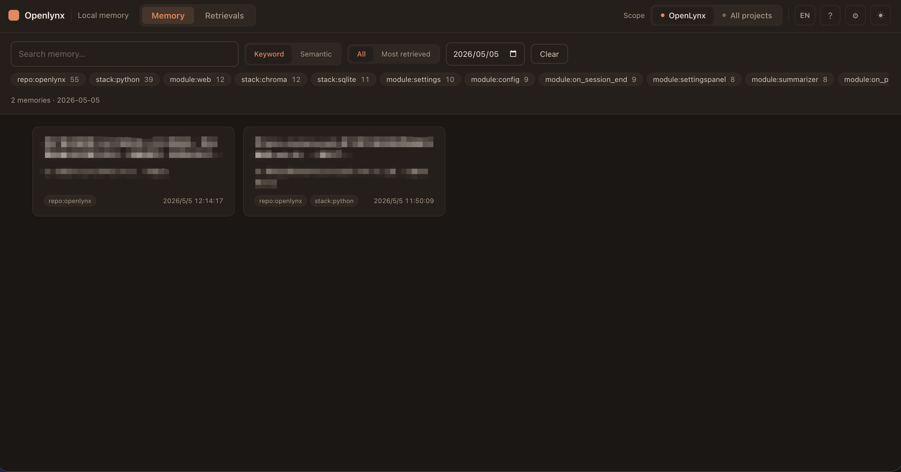

# lynx-memory

[](https://pypi.org/project/openlynx/)
[](https://pepy.tech/project/openlynx)
[](./LICENSE)

[中文 README](./README.zh-CN.md)

Persistent, semantic, long-term memory for [Claude Code](https://claude.com/claude-code).
Conversations are auto-saved across sessions and the most relevant snippets are
injected into context whenever you start a new prompt — no special syntax,
no "remember this" phrasing required.

```
You      : What can I do tomorrow if the weather's nice — maybe walk the dog?
Claude   : Since you've got Dandan (your golden Border Collie) who needs a lot
           of exercise, try a long walk, frisbee, or a bike ride with him
           tagging along… 🐶
            (you never mentioned Dandan or owning a dog — memory recalled it
             from a past chat)
```

## How it works

Three Claude Code [hooks](https://docs.claude.com/en/docs/claude-code/hooks) plus a small Python service:

| Hook               | What it does                                                                                |
| ------------------ | ------------------------------------------------------------------------------------------- |
| `UserPromptSubmit` | Embeds your prompt and injects the top-K most similar prior turns (a turn's **summary** is injected instead of raw prose when one exists). |
| `Stop`             | Persists the current turn into SQLite + Chroma, then spawns a detached summarizer (Claude via `claude -p`, or OpenAI / DeepSeek / Qwen) that writes the turn's memory note. |
| `SessionEnd`       | Detaches a worker that writes one session note (outcome, decisions, pitfalls, open loops) — replacing any earlier note for that session. |

On top of that, the **[work journal](#work-journal)** (`lynx-memory worklog`)
rolls everything up into per-project, per-day records of what actually got
done, plus a living card per project — built nightly by a scheduled job.

Storage:

- **SQLite** — source of truth for raw turns, per-turn summaries, and session summaries.
- **Chroma** — local vector index over turns + summaries.
- **Voyage AI** (`voyage-3.5`) — embeddings.
- **Claude** via headless Claude Code (`claude -p`, opt in with `SUMMARY_BACKEND=claude` — uses your own Claude login, no API key), or **OpenAI** (`gpt-4o-mini`), **DeepSeek** (`deepseek-chat`), **Qwen** (`qwen-turbo`) — summarization. Any one of these is enough.
- **Turso / libSQL** (optional, off by default) — when [cloud sync](#cloud-sync) is on, SQLite rows and vectors replicate to your own remote database for cross-machine recall.

## Install

```bash
pip install openlynx
lynx-memory init
```

`init` will:

1. Create the shared OpenLynx home at `~/.openlynx/`.
2. Prompt for your `VOYAGE_API_KEY` (get one free at https://www.voyageai.com/).
3. Write the default `.env` (`MIN_SCORE=0.7`, `SUMMARY_ENABLED=1`, `SUMMARY_BACKEND=auto`) — set `OPENAI_API_KEY`, `DEEPSEEK_API_KEY`, or `QWEN_API_KEY` to enable per-turn summarization (configurable later via the Web UI ⚙ Settings panel).
4. Back up your existing `~/.claude/settings.json` and add the three hooks.
5. Link shared commands and the OpenLynx skill into supported host directories.
6. Print verification steps.

If a legacy `~/.claude/lynx-memory/` store exists and `~/.openlynx/` does not,
`init` migrates it to `~/.openlynx/` before installing hooks. If both exist,
OpenLynx uses `~/.openlynx/` and leaves the legacy directory untouched.

The shared home is host-neutral:

```text
~/.openlynx/
  .env
  db/
  commands/
  skills/
```

Claude Code and Codex keep their own hook configuration files, but reusable
OpenLynx files are linked from this shared home into host directories such as
`~/.claude/commands/`, `~/.claude/skills/`, `~/.codex/commands/`, and
`~/.codex/skills/`.

Then open a fresh Claude Code session, chat for a few turns, and run:

```bash
lynx-memory status
```

You should see `turns` and `chroma_turns` counters going up.

## Codex CLI (cross-host memory)

Same memory store, also wired into [Codex CLI](https://developers.openai.com/codex/cli):

```bash
lynx-memory init --target codex   # or --target all to install both
```

This writes `~/.codex/hooks.json`, sets `[features] hooks = true` in
`~/.codex/config.toml`, and registers three hooks (`UserPromptSubmit` →
inject, `Stop` → persist, `SessionStart` → summarize the previous session,
since Codex has no `SessionEnd` event).

Codex's `additionalContext` field is fully respected, so retrieved memory is
injected exactly like in Claude Code. **Restart any running `codex` process for
hooks to take effect** — they're loaded at session start.

A turn typed in Claude Code can be recalled inside Codex (and vice versa)
because both write to the same SQLite + Chroma store at `~/.openlynx/`.

## CLI

| Command                  | What it does                                                                              |
| ------------------------ | ----------------------------------------------------------------------------------------- |
| `lynx-memory init`       | Install hooks, slash commands, and skill links (`--goal "…"` sets a global goal).         |
| `lynx-memory init-project` | Create a `.lynx-memory/` marker in cwd to enable project-level storage (`--goal "…"`).  |
| `lynx-memory status`     | Show data dir, hook registration, DB stats, and the active goal.                          |
| `lynx-memory goal`       | View/set/clear the per-scope goal (`goal show \| set "…" \| clear`, with `--scope`).      |
| `lynx-memory worklog`    | Work journal: `backfill` (all history), `run` (last 14 days, default for the scheduler), `status`, `show [--day D \| --project P]`, `export`. See [Work journal](#work-journal). |
| `lynx-memory schedule`   | Run the journal automatically: `install [--at HH:MM …]` (default 20:30 + 08:30), `uninstall`, `status`, `run-now` — launchd on macOS, cron on Linux. |
| `lynx-memory daily`      | Summarize a project's turns for today, optionally push to your phone (`--notify`, `--all`, `--project`, `--since-hours`). |
| `lynx-memory doctor`     | Verify Python, deps, API key, and `settings.json`.                                        |
| `lynx-memory merge`      | Merge memory between the project and global stores (`--from` / `--to`, with `--dry-run`). |
| `lynx-memory sync`       | Sync memory to the cloud via Turso (`init` / `init --all` / `status` / `reconcile`). See [Cloud sync](#cloud-sync). |
| `lynx-memory delete`     | Permanently delete memory for a scope (`--scope project\|global\|both`, double confirm).  |
| `lynx-memory uninstall`  | Remove hooks, slash commands, and skill links (keeps your data).                          |

## Goals

A **goal** is an optional, per-scope (project or global) statement of what
you're working toward. Set one at install time (`lynx-memory init` /
`init-project` prompt for it, or pass `--goal "…"`) or any time afterwards:

```bash
lynx-memory goal set "Ship the v2 billing API and migrate existing customers"
lynx-memory goal show          # project + global goals, gating state
lynx-memory goal clear         # active scope, asks to confirm
```

When a goal is set, OpenLynx changes two behaviors for that store:

- **Storage gating** — before a turn is persisted, the configured summarization
  LLM (OpenAI / DeepSeek / Qwen) judges whether it is relevant to the goal.
  Turns judged irrelevant never enter the database. The judgement is **strict**
  by default and **fails open**: if no LLM key is configured or the call errors
  out, the turn is stored, so memory is never lost on a hiccup. Every dropped
  turn is logged to `db/hook.log`.
- **Goal-focused summaries** — per-turn and per-session summaries are steered to
  prioritise information that advances the goal.

With no goal set, memory behaves exactly as before (every turn stored and
summarized). Changing a goal does not delete already-stored turns — it only
affects which future turns are kept. Tunables (`.env`):

| Variable              | Default  | Purpose                                          |
| --------------------- | -------- | ------------------------------------------------ |
| `GOAL_GATING_ENABLED` | `1`      | Set `0` to keep storing every turn even with a goal |
| `GOAL_STRICTNESS`     | `strict` | `loose` \| `balanced` \| `strict`                |
| `GOAL_JUDGE_TIMEOUT`  | `8`      | Seconds for the relevance LLM call (`0` = none)  |

## Work journal

Raw memory answers *"what did we say?"*. The work journal answers *"what did I
ship, decide, learn — and what is still open?"* — for every project, every day.
`lynx-memory worklog` reads all stores on the machine and has Claude (headless
`claude -p`) write it, layer on layer:

```text
turns (+ per-turn notes)
  └─► unit = one project × one day ──────────────► project card (rolling)
        work items  status: done │ done-unverified │      summary · state · open loops
                    uncommitted │ blocked:<who> │         decisions in force · pitfalls
                    discussed-only │ abandoned            definitions · metrics · milestones
        facts       pitfalls · definitions · findings
                    · preferences   (+ evidence turn ids)
```

What to keep, and how, was settled by a multi-agent review of real memory
(knowledge-value, pipeline and consumer perspectives):

- **Honest status** — a plan is not *done*; edited-but-untested is
  `done-unverified`; not committed is `uncommitted`; waiting on someone is
  `blocked:<who>`.
- **Anchors or it didn't happen** — every item cites a file, commit, version,
  number or table; vague "improved X" lines are dropped.
- **Decisions keep the why** and the rejected alternative; a plan reversed
  during the day is recorded once, in its final state. Rework is counted.
- **Two streams** — *progress* (for reviews) and reusable *facts* (pitfalls,
  metric definitions, findings with their scope — for "how did I fix X?").
- **Noise never reaches the model** — CLAUDE.md reminders, skill bodies and
  subagent notifications are stripped; templated batch jobs recorded as memory
  (e.g. `claude -p` pipelines) are detected and only counted. Secrets are
  redacted.

### Build it once, then let it run

```bash
echo "SUMMARY_BACKEND=claude" >> ~/.openlynx/.env   # use Claude Code headless

lynx-memory worklog backfill --dry-run   # units / LLM calls it would make
lynx-memory worklog backfill --jobs 5    # summarize ALL history (resumable)
lynx-memory schedule install             # then 20:30 + 08:30 every day

lynx-memory worklog status               # coverage, backend, schedule
lynx-memory worklog show                 # today's log
lynx-memory worklog show --project app   # a project card
```

Every unit carries a fingerprint of its input, so a run only rebuilds what
changed: the nightly run is cheap, a re-run is free, and nights the machine was
asleep or off are caught up automatically (the scheduled run covers the last 14
days). Units build in parallel; a crashed run resumes from
`~/.openlynx/worklog/.staging.jsonl`. Results are written to the global store
(`worklog_units`, `work_items`, `project_cards`) in **one transaction** and
rendered to plain files — a stable interface for people and other agents:

```text
~/.openlynx/worklog/
  days/YYYY-MM-DD.md     per-day log, grouped by project
  projects/<name>.md     project cards (+ <name>.json)
  open-loops.md          every open loop, across projects
  latest.md · index.json
```

**Where it shows up**

- **Web UI → Work log**: browse days, project cards and open loops, and search
  work items / facts.
- **New sessions** get their project's card once, on the first prompt, as a
  `<project-brief>` (≈1.4k chars max, flagged as possibly outdated). Turn off
  with `WORKLOG_INJECT_BRIEF=0`.

**Projects.** A project store owns its turns. In the global store the working
directory decides — a directory inside a project that has its own store maps to
that project; temp dirs, `~` and `~/Desktop` are buckets, not projects. Skip
paths with `WORKLOG_EXCLUDE="*/scratch*,*/private"`.

**The `claude` backend.** Each call is an isolated `claude -p` (no tools, no MCP
servers, hooks disabled, `LYNX_MEMORY_NO_HOOK=1`, no session file), so a
summary never records itself as memory. Models: `CLAUDE_MODEL` (default
`sonnet`) for journal units, cards and session notes; `CLAUDE_FAST_MODEL`
(default `haiku`) for per-turn notes and the goal judge. With this backend the
goal judge runs in the background worker (the turn is stored first and
soft-deleted if judged irrelevant), keeping the `Stop` hook fast. `claude` is
never picked by `SUMMARY_BACKEND=auto` — it spends your Claude plan, so it is
opt-in. For scheduled runs, `claude setup-token` once and put
`CLAUDE_CODE_OAUTH_TOKEN=…` in `~/.openlynx/.env`; launchd jobs can't refresh a
keychain login reliably.

## Daily digest

> The [work journal](#work-journal) is the durable, structured successor: it is
> stored, covers every project, and is what the scheduler builds. `daily`
> remains for quick ad-hoc recaps and phone pushes.

`lynx-memory daily` summarizes a project's turns for the day (since local
midnight, or `--since-hours N`) into a short "what I did today" recap — reusing
each turn's existing summary when present, and steering toward the goal if one
is set. It prints by default; `--notify` pushes it to your phone.

```bash
lynx-memory daily                                  # print today's recap for cwd's project
lynx-memory daily --project ~/code/app --notify    # build + push for one project
lynx-memory daily --all --notify                   # aggregate EVERY store on the machine
```

`--all` scans for every store on the machine (the global store + each project's
`.lynx-memory/`) and produces one cross-project recap grouped by project — so
you see everything you did today, not just one repo. The scan walks `$HOME`
(override roots with `LYNX_SCAN_ROOTS`, depth with `LYNX_SCAN_DEPTH`), skipping
big/noisy directories.

Notifier backends (auto-detected from env, or forced via `DAILY_NOTIFY_BACKEND`):

| Backend      | Env                  | Notes                                 |
| ------------ | -------------------- | ------------------------------------- |
| `serverchan` | `SERVERCHAN_SENDKEY` | WeChat push via ServerChan (Server酱) |
| `webhook`    | `DAILY_WEBHOOK_URL`  | Generic JSON `POST {"title","body"}`  |

To run it automatically every night, schedule it with your OS scheduler. On
macOS, a `launchd` LaunchAgent with `StartCalendarInterval` (e.g. `Hour 21`)
running `lynx-memory daily --all --notify` is the most reliable option; wrap it
in `caffeinate -i` and add a `pmset repeat wakeorpoweron` a couple of minutes
earlier so it fires even while the Mac sleeps. On Linux, a `cron` entry works.

## Slash commands

`lynx-memory init` also installs six global slash commands into
`~/.openlynx/commands/` and links them into host command directories such as
`~/.claude/commands/` and `~/.codex/commands/`:

| Command                    | What it does                                                       |
| -------------------------- | ----------------------------------------------------------------- |
| `/lynx-memory-status`      | Show current scope (project vs global) with stats for both.       |
| `/lynx-memory-goal`        | View or set the per-scope goal (gates storage, focuses summaries).|
| `/lynx-memory-pull-global` | Merge global memory into the current project (global → project).  |
| `/lynx-memory-push-global` | Merge current project memory into global (project → global).      |
| `/lynx-memory-delete`      | Delete memory with mandatory double confirm (`DELETE` + `y`).     |
| `/lynx-memory-history`     | Open a local Web UI to browse, search, tag, and delete turns.     |

Each of these runs `lynx-memory status` / `merge --dry-run` first and asks for
your approval before any write or destructive action.

## Skills

`lynx-memory init` installs the bundled OpenLynx skill into
`~/.openlynx/skills/openlynx/` and links it into supported host skill
directories such as `~/.claude/skills/openlynx` and `~/.codex/skills/openlynx`.

## Web UI



Type `/lynx-memory-history` in Claude Code (or run `lynx-memory web`) to launch
a local FastAPI + React UI on `127.0.0.1`. The page opens automatically in your
browser and lets you:

- Browse memory as a **card gallery**; click any card to open its full content, summary, tags and retrieval history in a side **drawer**.
- Switch lens between **Memory** (stored turns), **Retrievals** (when a memory was recalled by a later prompt) and **Work log** (the [work journal](#work-journal): per-day logs, project cards, open loops, and search over work items and facts).
- Switch between **project** and **global** scopes.
- Search by **keyword** (SQL `LIKE`) or **semantic** similarity (Voyage embeddings), **filter by date**, filter by **tag**, or sort by **most-retrieved**.
- Tag turns (e.g. `#work`, `#personal`) and delete a single turn (also clears its embedding from Chroma).
- See the per-turn **summary** as the card lead, with a one-click button to (re)generate it on demand.
- Switch interface language — **English by default**, with a one-click **中文** toggle in the top bar.
- Click the **⚙ gear icon** (top-right) to open the **Settings panel** — a left-hand menu with **Embeddings**, **Memory injection**, **Summarization**, and **Cloud sync (Turso)** sections. Configure API keys, summary backend (OpenAI / DeepSeek / Qwen), model, Top-K, min score, and retrieval scope. The **Cloud sync** section separates the two cases: **global store sync** (an enable toggle + the global database's URL & token) and **auto-provision project databases** (Turso API token + org/group, used by `sync init`). Everything saves directly to `~/.openlynx/.env`.

### Usage

```bash
# default — listens on http://127.0.0.1:9527 and opens your browser
lynx-memory web

# pick a different port
lynx-memory web --port 8080

# or let the OS assign a free port
lynx-memory web --port 0

# don't auto-open the browser (useful in headless / SSH sessions)
lynx-memory web --no-open
```

| Action                 | What happens on disk                                                                       |
| ---------------------- | ------------------------------------------------------------------------------------------ |
| **Delete a turn**      | Row removed from SQLite `turns` and `turn_tags`; embedding removed from Chroma.             |
| **Add a tag**          | Inserted into SQLite `tags` (created on demand) and `turn_tags`.                            |
| **Remove a tag**       | Row removed from `turn_tags`; orphaned tag is GC'd from `tags`.                             |
| **Search (keyword)**   | SQL `LIKE` over `user_msg` and `assistant_msg` — no embedding call.                         |
| **Search (semantic)**  | One Voyage embedding per query, then top-K from Chroma.                                     |
| **Filter by date**     | SQL filter on the turn timestamp (`ts >= start AND ts < start + 1 day`) — no embedding call. |
| **Regenerate summary** | One API call (per `SUMMARY_BACKEND`); writes `summary` / `summary_model` / `summary_ts` back into the `turns` row. |

The server only binds to `127.0.0.1`. Press `Ctrl+C` to stop it.

## Project-level vs global

Memory is global by default. Run this in a project root:

```bash
cd ~/code/my-project
lynx-memory init-project
```

It creates a `.lynx-memory/` marker. As long as your cwd is inside that project,
memory transparently switches to the project-level store at
`<project>/.lynx-memory/db/`, isolated from the global one at `~/.openlynx/`.

Use `/lynx-memory-status` to inspect the active scope, and
`/lynx-memory-pull-global` / `/lynx-memory-push-global` to move history between
the two layers.

## Cloud sync

Keep your memory in the cloud and recall it from any machine. OpenLynx uses
[Turso](https://turso.tech) (libSQL) **embedded replicas**: reads and writes hit
a fast local SQLite file while changes sync to a remote database in the
background — local-first, with no server of your own to run.

Each project gets its **own** database and the global store gets one too, so
histories never mix. A project's stable identity is derived from its **git
remote**, so the same repo on two machines maps to the same database; projects
without a remote fall back to a path-based id.

**Setup** — create a free Turso account and an **API token**, then add your
credentials either in `~/.openlynx/.env` or via the Web UI **⚙ Settings → Cloud
sync (Turso)** panel (`TURSO_API_TOKEN`, `TURSO_ORG`, `TURSO_GROUP`). Then
provision + upload a store:

```bash
cd ~/code/my-project
lynx-memory sync init          # this project: create its DB + upload local data
lynx-memory sync init --all    # every project store on the machine
lynx-memory sync status        # show what's configured (global + current project)
```

`sync init` writes `<project>/.lynx-memory/sync.json` (auto-gitignored — it holds
the per-project database token). On another machine, clone the repo and run
`lynx-memory sync init` again: the git-remote-derived id binds it to the same
database, and the next sync pulls your existing memory down.

The **global** store syncs separately through the `OPENLYNX_SYNC_*` env vars
(also editable in the Settings panel, where the **Enable cloud sync** toggle
flips `OPENLYNX_SYNC_ENABLED`). Both relational rows and vector embeddings are
synced, so semantic search works across machines without re-embedding.

If a hook can't get the replica's lock in time (or the remote is unreachable),
it writes the turn to the plain local `db/memory.db` rather than lose it.
`lynx-memory sync reconcile [--dry-run]` merges those stranded rows back into
the synced replica (newer copies of the same turn win; rows older than the
replica are never resurrected), and every `worklog` run does it automatically.

## Configuration

All optional, set in `~/.openlynx/.env`:

| Variable          | Default                       | Purpose                                            |
| ----------------- | ----------------------------- | -------------------------------------------------- |
| `VOYAGE_API_KEY`  | —                             | Required for embeddings                            |
| `TOP_K`           | `5`                           | Max memories injected per prompt                   |
| `MIN_SCORE`       | `0.7`                         | Cosine similarity floor (0–1)                      |
| `SUMMARY_ENABLED` | `1`                           | Set `0`/`false` to disable per-turn summarization  |
| `SUMMARY_BACKEND` | `auto`                        | `auto` → first provider with a key (OpenAI → DeepSeek → Qwen); force with `claude`, `openai`, `deepseek`, or `qwen`. A forced backend never falls back to another. |
| `CLAUDE_MODEL`    | `sonnet`                      | `claude` backend: journal units, project cards, session notes |
| `CLAUDE_FAST_MODEL` | `haiku`                     | `claude` backend: per-turn notes and the goal judge |
| `CLAUDE_BIN`      | `claude` on `PATH`            | Path to the Claude Code CLI                         |
| `CLAUDE_TIMEOUT`  | `300`                         | Seconds per `claude -p` call                        |
| `CLAUDE_CODE_OAUTH_TOKEN` | —                     | Long-lived token from `claude setup-token`, for scheduled (launchd/cron) runs |
| `WORKLOG_DIR`     | `~/.openlynx/worklog`         | Where the journal is exported                      |
| `WORKLOG_EXCLUDE` | —                             | Comma-separated globs of project paths to leave out |
| `WORKLOG_INJECT_BRIEF` | `1`                      | Inject the project card on a session's first prompt |
| `WORKLOG_LANG`    | auto                          | `zh` / `en` labels in the exported Markdown         |
| `OPENAI_API_KEY`  | —                             | Required when `SUMMARY_BACKEND=openai`             |
| `OPENAI_MODEL`    | `gpt-4o-mini`                 | OpenAI model used for summarization                |
| `OPENAI_BASE_URL` | `https://api.openai.com/v1`   | Override for OpenAI-compatible endpoints           |
| `DEEPSEEK_API_KEY`| —                             | Required when `SUMMARY_BACKEND=deepseek`           |
| `DEEPSEEK_MODEL`  | `deepseek-chat`               | DeepSeek model used for summarization              |
| `DEEPSEEK_BASE_URL`| `https://api.deepseek.com/v1`| Override for the DeepSeek endpoint                 |
| `QWEN_API_KEY`    | —                             | Required when `SUMMARY_BACKEND=qwen` (`DASHSCOPE_API_KEY` also accepted) |
| `QWEN_MODEL`      | `qwen-turbo`                  | Qwen model used for summarization                  |
| `QWEN_BASE_URL`   | DashScope compatible-mode URL | Override for the Qwen/DashScope endpoint           |
| `LYNX_MEMORY_DIR` | `~/.openlynx`                 | Where SQLite + Chroma live                         |
| `TURSO_API_TOKEN` | —                             | Turso API token; provisions per-project DBs via `lynx-memory sync init` |
| `TURSO_ORG`       | —                             | Turso organization slug                            |
| `TURSO_GROUP`     | `default`                     | Turso database group new project DBs are created in |
| `OPENLYNX_SYNC_URL` | —                           | libSQL URL of the **global** store's Turso database |
| `OPENLYNX_SYNC_TOKEN` | —                         | Auth token for the global store's database         |
| `OPENLYNX_SYNC_ENABLED` | `0`                     | Set `1` to sync the global store                   |
| `OPENLYNX_SYNC_INTERVAL` | `60`                   | Min seconds between background replica syncs        |

See [Cloud sync](#cloud-sync), [Goals](#goals), [Work journal](#work-journal) and [Daily digest](#daily-digest) for more on these env vars.

## Optional: MCP server

You can also expose memory as MCP tools for Claude Code (`search_memory`,
`list_recent`, `stats`, `forget`). Add to `~/.claude.json` or `.mcp.json`:

```json
{
  "mcpServers": {
    "lynx-memory": {
      "command": "lynx-memory-mcp"
    }
  }
}
```

## Uninstall

```bash
lynx-memory uninstall                   # remove hooks + slash commands + skill links
lynx-memory delete --scope global       # delete the global store (confirms)
# or
rm -rf ~/.openlynx                       # nuke directly (irreversible)
```

## Privacy

- All data stays on your machine in `~/.openlynx/`.
- Outbound calls: **Voyage AI** for embeddings (your prompt text); **OpenAI**, **DeepSeek**, or **Qwen** for per-turn and session summaries (requires an API key — set via `.env` or the Web UI ⚙ Settings panel).
- Set `SUMMARY_ENABLED=0` if you don't want per-turn summaries to leave the box.
- **Cloud sync is off by default.** When you enable it, your memory (turns,
  summaries, tags, and vector embeddings) is uploaded to **your own** Turso
  database. Leave it disabled to keep everything local-only.
- Set `LYNX_MEMORY_DIR` to encrypt at rest with whatever filesystem-level encryption your OS provides.

## Roadmap

- [x] **Project-level / global dual-layer storage**
  Global by default; auto-switches to project-level when a `.lynx-memory/`
  marker is found by walking up from cwd, so histories from different projects
  don't bleed into each other. Run `lynx-memory init-project` in a project root
  to create the marker. Search supports `scope=auto|project|global|merged`
  (hooks via `LYNX_MEMORY_SCOPE` env; MCP tools accept a `scope` argument).

- [x] **Codex CLI** — same hooks + shared store; use `lynx-memory init --target codex` (or `--target all`). See [Codex CLI](#codex-cli-cross-host-memory) above.

- [x] **Local Web UI memory browser**
  A local FastAPI + React UI with paging, keyword / semantic search,
  single-turn deletion, and tagging (e.g. `#work`, `#personal`). Launch with
  `/lynx-memory-history` (or `lynx-memory web`); the page exposes both
  project-level and global histories with a one-click scope toggle.

- [x] **Goals & daily digest** — set a per-scope goal to gate storage and focus summaries; `lynx-memory daily` recaps your day (per project or `--all`) and can push it to your phone.

- [x] **Work journal** — Claude-written, per-project/per-day records with honest status, reusable facts and rolling project cards; full-history backfill, scheduled catch-up, Web UI tab, and session-start project briefs. See [Work journal](#work-journal).

- [ ] **Weekly / monthly reviews** — roll the day units up into week and month summaries.

- [ ] **Other CLIs (Cursor, Gemini CLI, …)** — not integrated yet. **Cursor**: blocked until a stable hooks surface ships (we plan to adopt it once available); meanwhile MCP-only workflows remain possible where applicable.

- [ ] **Unified multi-client installer**
  A future `lynx-memory install --client <name>` to write MCP configs in one
  shot, with rules templates for consistent recall across clients that support them.

- [x] **Cross-device cloud sync** — `lynx-memory sync init` syncs each store to
  its own Turso (libSQL) database via local-first embedded replicas, keyed off
  the git remote so the same repo recalls the same memory on any machine. See
  [Cloud sync](#cloud-sync).

- [ ] **Import / export** — `lynx-memory export` / `import` for JSONL backup and
  restore, independent of the cloud-sync path above.

- [ ] **Richer automatic tagging (precise vs associative)**
  Stronger auto-labeling for turns, with a switchable **precise** mode (tight,
  literal, auditable tags) vs **associative** mode (broader links and softer
  clusters to improve semantic recall).

- [ ] **Recall modes & tunable ranking**
  Let users steer what gets injected beyond raw similarity — combine signals
  such as **retrieval / hit count**, **relevance score**, and **recency**, with
  presets or manual weighting so priority matches your workflow.

## Changelog

Full history on [GitHub Releases](https://github.com/by123/OpenLynx/releases).

- **0.8.0** — **Work journal** (`lynx-memory worklog`): every store's history summarized by Claude into project × day units (work items with honest status, reusable facts, evidence) and rolling project cards; `backfill` for all history, fingerprint-based incremental runs, resumable staging, single-transaction writes; Markdown/JSON exports; **Work log** tab in the Web UI; project brief injected on a session's first prompt. **`claude` summarization backend** (headless `claude -p`, opt-in) for turn notes, session notes and the goal judge (deferred to the background worker). **`lynx-memory schedule`** installs the nightly job (launchd / cron) with automatic catch-up. Reliability: background workers no longer hold the store's replica lock during LLM calls; `lynx-memory sync reconcile` (and every journal run) merges rows stranded in the local fallback DB back into synced replicas; store discovery recognizes replica-only stores. Quality: harness noise (CLAUDE.md reminders, skill bodies, task notifications) is stripped before summarizing and no longer triggers recall; new typed note format (`[decision]`, `[pitfall]`, `[todo]` …); one session note per session, written from each reply's conclusion rather than its head.
- **0.7.2** — Cross-process lock for the libSQL replica; set-based batch operations.
- **0.7.1** — Soft-delete for turns and summaries, propagated through sync.
- **0.7.0** — Web UI: one tab per project, bulk delete, project visibility.

- **0.6.0** — **Cloud sync** via Turso (libSQL) embedded replicas: `lynx-memory sync init` provisions a per-project database (keyed off the git remote for stable cross-machine recall), `--all` syncs every store, and both rows and vector embeddings are uploaded. The Web UI ⚙ Settings panel is reorganized into a **left-hand menu**, with a **Cloud sync (Turso)** section that splits global-store sync from project-database provisioning.
- **0.5.0** — Redesigned web UI: full-width card gallery + side detail drawer, warm theme. Interface internationalized (**English by default**, one-click **中文**). Date filter on the memory list (`/api/turns` gains `since` / `until`).

## License

MIT — see [LICENSE](./LICENSE).
