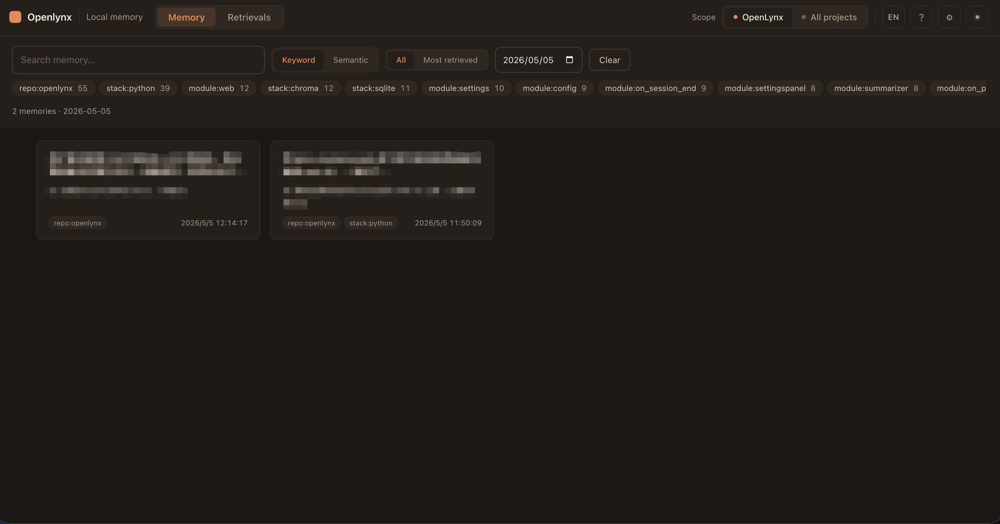

# lynx-memory

[](https://pypi.org/project/openlynx/)
[](https://pepy.tech/project/openlynx)
[](./LICENSE)

[English README](./README.md)

为 [Claude Code](https://claude.com/claude-code) 提供持久、语义化的长期记忆。
对话会跨会话自动保存，每次你提交新消息时，最相关的历史片段会自动注入上下文——
不需要特殊语法，也不用说"还记得 XX 吗"。

```
你       : 明天天气好的话，我可以有哪些活动，比如遛狗
Claude   : 结合你有蛋蛋（金色边牧）这个大运动量的伙伴，可以安排长距离散步、
           玩飞盘、城市绿道骑行带它跟跑…… 🐶
            （你没提"蛋蛋"，也没说自己养狗——记忆从过往聊天里自动召回）
```

## 工作原理

三个 Claude Code [hooks](https://docs.claude.com/en/docs/claude-code/hooks) + 一个小 Python 服务：

| Hook               | 作用                                                                                |
| ------------------ | ----------------------------------------------------------------------------------- |
| `UserPromptSubmit` | 把你的 prompt 向量化，注入最相似的 K 条历史对话；命中的 turn 若已有摘要，注入**摘要**而非原文。 |
| `Stop`             | 把本轮对话存入 SQLite + Chroma，并 detached fork 一个后台摘要进程（Claude `claude -p`，或 OpenAI / DeepSeek / Qwen）写这一轮的记忆笔记。 |
| `SessionEnd`       | 分离出一个后台进程，为整段会话写一份会话笔记（结果、决策、踩坑、未闭环），同一会话只保留最新一份。 |

在此之上，**[工作日志](#工作日志)**（`lynx-memory worklog`）把全部记录汇总成「每个项目 ×
每一天到底做成了什么」，并为每个项目维护一张持续更新的项目卡——由定时任务每晚自动构建。

存储方式：

- **SQLite** — 原始对话、每轮摘要、会话级摘要的真实数据源。
- **Chroma** — 本地向量索引（turns + 摘要）。
- **Voyage AI** (`voyage-3.5`) — 文本向量化服务。
- **Claude**（无头 Claude Code `claude -p`，用 `SUMMARY_BACKEND=claude` 显式开启——走你自己的 Claude 登录，无需 API key），或 **OpenAI**（`gpt-4o-mini`）、**DeepSeek**（`deepseek-chat`）、**Qwen**（`qwen-turbo`）— 负责各级摘要，任选其一即可。
- **Turso / libSQL**（可选，默认关闭）— 开启[云端同步](#云端同步)后，SQLite 数据与向量会复制到你自己的远程数据库，实现跨电脑召回。

## 安装

```bash
pip install openlynx
lynx-memory init
```

`init` 会：

1. 创建共享的 OpenLynx 主目录 `~/.openlynx/`。
2. 提示你输入 `VOYAGE_API_KEY`（免费申请：https://www.voyageai.com/）。
3. 写入默认配置 `MIN_SCORE=0.7`、`SUMMARY_ENABLED=1`、`SUMMARY_BACKEND=auto`；设置 `OPENAI_API_KEY`、`DEEPSEEK_API_KEY` 或 `QWEN_API_KEY` 以启用每轮摘要（也可之后在 Web UI ⚙ 设置面板里配置）。
4. 备份现有的 `~/.claude/settings.json`，注入三个 hook。
5. 把共享 commands 和 OpenLynx skill 链接到支持的宿主目录。
6. 打印验证步骤。

如果旧版 `~/.claude/lynx-memory/` 存在且 `~/.openlynx/` 不存在，`init` 会先迁移到
`~/.openlynx/` 再安装 hooks。如果两个目录都存在，OpenLynx 会使用 `~/.openlynx/`，
并保留旧目录不做自动合并。

共享主目录不属于任何单一宿主：

```text
~/.openlynx/
  .env
  db/
  commands/
  skills/
```

Claude Code 和 Codex 仍保留各自的 hook 配置文件，但 OpenLynx 可复用文件会从这个
共享主目录链接到 `~/.claude/commands/`、`~/.claude/skills/`、`~/.codex/commands/`、
`~/.codex/skills/` 等宿主目录。

然后开一个新的 Claude Code 会话，聊几轮后跑：

```bash
lynx-memory status
```

你应该能看到 `turns` 和 `chroma_turns` 在涨。

## Codex CLI（跨宿主记忆）

同一份记忆库也可以接入 [Codex CLI](https://developers.openai.com/codex/cli)：

```bash
lynx-memory init --target codex   # 或 --target all 同时安装两边
```

会写入 `~/.codex/hooks.json`，在 `~/.codex/config.toml` 设置
`[features] hooks = true`，并注册三个 hook（`UserPromptSubmit` → 注入；
`Stop` → 持久化；`SessionStart` → 给上一段会话生成摘要，因为 Codex 没有
`SessionEnd` 事件）。

Codex 的 `additionalContext` 字段会被完整尊重，记忆注入方式与 Claude Code 一致。
**hook 在会话启动时加载，请重启正在运行的 `codex` 进程后才会生效。**

在 Claude Code 写下的对话可以在 Codex 里被召回（反之亦然），因为两边都写入同一个
`~/.openlynx/` 下的 SQLite + Chroma 仓库。

## 命令

| 命令                       | 作用                                                                            |
| -------------------------- | ------------------------------------------------------------------------------- |
| `lynx-memory init`         | 安装 hooks、slash 命令与 skill 链接（`--goal "…"` 设置全局目标）。               |
| `lynx-memory init-project` | 在当前目录创建 `.lynx-memory/` 标记，启用项目级存储（`--goal "…"` 设置项目目标）。 |
| `lynx-memory status`       | 查看数据目录、hook 注册情况、数据库统计、当前目标。                             |
| `lynx-memory goal`         | 查看 / 设置 / 清除按 scope 划分的目标（`goal show \| set "…" \| clear`，可选 `--scope`）。 |
| `lynx-memory worklog`      | 工作日志：`backfill`（全部历史）、`run`（最近 14 天，定时任务用它）、`status`、`show [--day D \| --project P]`、`export`。详见 [工作日志](#工作日志)。 |
| `lynx-memory resummarize`  | 用当前后端重写所有历史的逐轮笔记和会话笔记（例如把旧模型写的历史全部换成 Claude 写）：`--jobs N` 并发，可断点续跑（已重写的自动跳过），`--what turns,sessions`，`--dry-run`。 |
| `lynx-memory restore-pruned` | 撤销裁剪：恢复被判为无价值而删除的 turn，并重新向量化（`--store`、`--since`、`--dry-run`）。 |
| `lynx-memory schedule`     | 自动运行工作日志：`install [--at HH:MM …]`（默认 20:30 + 08:30）、`uninstall`、`status`、`run-now`——macOS 用 launchd，Linux 用 cron。 |
| `lynx-memory daily`        | 汇总项目当天的对话生成日报，可选推送到手机（`--notify`、`--all`、`--project`、`--since-hours`）。 |
| `lynx-memory doctor`       | 自检 Python、依赖、API key、`settings.json`。                                    |
| `lynx-memory merge`        | 在项目级 / 全局两个仓库之间合并记忆（`--from` / `--to` 选 `project\|global`，可选 `--dry-run`）。 |
| `lynx-memory retag`        | 给历史 turn 回填结构化自动标签（`--scope project\|global\|both`，可选 `--dry-run` / `--limit`）。 |
| `lynx-memory sync`         | 通过 Turso 把记忆同步到云端（`init` / `init --all` / `status` / `reconcile`）。详见 [云端同步](#云端同步)。 |
| `lynx-memory delete`       | 永久删除某个 scope 的记忆（`--scope project\|global\|both`，默认带二次确认）。   |
| `lynx-memory uninstall`    | 卸载 hooks、slash 命令与 skill 链接（保留数据）。                               |

## 目标（Goals）

**目标**是按 scope（项目级或全局）设置的、描述你当前在做什么的一句话，可选。可以在
安装时设置（`lynx-memory init` / `init-project` 会询问，或用 `--goal "…"`），也可以
随时设置：

```bash
lynx-memory goal set "上线 v2 计费 API 并迁移现有客户"
lynx-memory goal show          # 查看项目级 + 全局目标、gating 状态
lynx-memory goal clear         # 清除当前 scope 的目标（需确认）
```

设置目标后，该仓库会改变两个行为：

- **存储 gating**：每个 turn 写库前，由配置的摘要 LLM（OpenAI / DeepSeek / Qwen）判断
  它是否与目标相关；判定为无关的 turn 不会进入数据库。默认采用**严格**判定，且**失败
  时放行**——若没有配置 LLM key 或调用出错，turn 仍会被存储，绝不因抖动丢记忆。每条
  被丢弃的 turn 都会记录到 `db/hook.log`。
- **结合目标的摘要**：单轮与整段会话的摘要都会优先保留推进目标的信息。

未设置目标时，行为与之前完全一致（所有 turn 照常存储与摘要）。修改目标不会删除已
存储的 turn，只影响之后哪些 turn 会被保留。可调项（`.env`）：

| 变量                  | 默认值   | 用途                                       |
| --------------------- | -------- | ------------------------------------------ |
| `GOAL_GATING_ENABLED` | `1`      | 设 `0` 则即使设了目标也照常存储所有 turn   |
| `GOAL_STRICTNESS`     | `strict` | `loose` \| `balanced` \| `strict`          |
| `GOAL_JUDGE_TIMEOUT`  | `8`      | 相关性 LLM 调用超时（秒，`0` = 不限）       |

## 工作日志

原始记忆回答的是「我们说过什么」；工作日志回答的是「我交付了什么、定了什么、学到了什么、还有什么没收尾」——
覆盖每个项目、每一天。`lynx-memory worklog` 读取本机所有记忆库，由 Claude（无头 `claude -p`）逐层写成：

```text
turns（+ 每轮笔记）
  └─► 单元 = 一个项目 × 一天 ─────────────────────► 项目卡（持续更新）
        工作项  状态：done │ done-unverified │             一句话定位 · 现状 · 未闭环
              uncommitted │ blocked:<谁> │                 现行决策 · 踩坑
              discussed-only │ abandoned                    口径/定义 · 指标 · 里程碑
        知识    踩坑 · 口径定义 · 结论 · 偏好（+ 证据 turn id）
```

「留什么、怎么写」是让多个 agent 基于真实记忆数据讨论定下来的（知识价值 / 管线架构 / 消费端三个视角）：

- **状态诚实**——想清了≠做了；改了没测是 `done-unverified`；没提交是 `uncommitted`；
  卡在别人那里是 `blocked:<谁>`。
- **没有锚点就不写**——每条都要带文件、commit、版本、数字或表名；「优化了 X」这类空话直接丢弃。
- **决策带理由**，也写被否掉的方案；当天反转的只记最终状态；返工次数会被记录。
- **两路输出**——「进展」用于复盘，「知识」（踩坑、指标口径、带口径的结论）用于检索「上次怎么解决 X 的」。
- **噪音不进模型**——CLAUDE.md 注入、skill 正文、子 agent 通知会先被清洗；被记成记忆的模板化批处理
  （例如 `claude -p` 流水线）会被识别出来，只计数不总结。密钥类信息会被脱敏。

### 先回填一次，之后自动运行

```bash
echo "SUMMARY_BACKEND=claude" >> ~/.openlynx/.env   # 用无头 Claude Code 总结

lynx-memory worklog backfill --dry-run   # 先看要建多少单元、调多少次 LLM
lynx-memory worklog backfill --jobs 5    # 总结全部历史（可断点续跑）
lynx-memory schedule install             # 之后每天 20:30 + 08:30 自动跑
lynx-memory resummarize --jobs 16        # 可选：用 Claude 重写所有旧的逐轮 / 会话笔记
                                         #   （加 --prune 顺带删除被判为无价值的 turn）

lynx-memory worklog status               # 覆盖范围、后端、定时任务
lynx-memory worklog show                 # 今天的日志
lynx-memory worklog show --project app   # 某个项目的项目卡
```

每个单元都带一份输入指纹，所以每次只重建有变化的部分：每晚的增量很便宜，重复运行不花钱，
电脑睡眠或关机错过的那几天会在下次运行时自动补齐（定时任务覆盖最近 14 天）。单元并行构建；
中途崩溃会从 `~/.openlynx/worklog/.staging.jsonl` 续跑。结果在**一个事务**里写入全局库
（`worklog_units`、`work_items`、`project_cards`），并渲染成普通文件——给人看，也给其他 agent 用：

```text
~/.openlynx/worklog/
  days/YYYY-MM-DD.md     每日日志，按项目分组
  projects/<名称>.md      项目卡（另有 <名称>.json）
  open-loops.md          所有项目的未闭环事项
  latest.md · index.json
```

**在哪里用到**

- **Web UI → 工作日志**：按天浏览、看项目卡和未闭环，并可搜索工作项和知识。
- **新会话**：在第一条提问时注入一次当前项目的项目卡（`<project-brief>`，最多约 1.4k 字符，
  并标明「可能过时，以代码 / git 为准」）。用 `WORKLOG_INJECT_BRIEF=0` 关闭。

**项目归属。** 项目级记忆库的 turn 都归该项目。全局库按工作目录归属——位于某个已有项目库内的目录归到该项目；
临时目录、`~` 和 `~/Desktop` 归入杂项桶，不算项目。用 `WORKLOG_EXCLUDE="*/scratch*,*/private"` 排除路径。

**`claude` 后端。** 每次调用都是隔离的 `claude -p`（无工具、无 MCP、禁用 hooks、`LYNX_MEMORY_NO_HOOK=1`、
不落会话文件），所以总结过程永远不会把自己记成记忆。模型：`CLAUDE_MODEL`（默认 `sonnet`）用于工作日志单元、
项目卡、会话笔记；`CLAUDE_FAST_MODEL`（默认 `haiku`）用于每轮笔记和目标判定。使用该后端时，目标相关性判定
挪到后台进程执行（turn 先入库，判为无关再软删除），`Stop` hook 不会变慢。`SUMMARY_BACKEND=auto` 永远不会自动选
`claude`——它消耗的是你的 Claude 套餐额度，需要显式开启。设置 `CLAUDE_USAGE_CAP=0.8`，可避免 OpenLynx 用掉 5 小时窗口最后的 20%（`lynx-memory worklog status` 会显示当前用量）。定时任务场景下请先 `claude setup-token`，把
`CLAUDE_CODE_OAUTH_TOKEN=…` 写进 `~/.openlynx/.env`；launchd 任务无法可靠地刷新钥匙串里的登录态。

## 每日日报

> [工作日志](#工作日志) 是它的持久化、结构化升级版：会落库、覆盖所有项目，也是定时任务构建的内容。
> `daily` 保留用于临时快速回顾和推送到手机。

`lynx-memory daily` 把项目当天的对话（本地 00:00 起，或 `--since-hours N`）汇总成一段
简短的「今天我做了什么」日报——优先复用每条已有的摘要，设了目标的话会围绕目标。
默认只打印，加 `--notify` 推送到手机。

```bash
lynx-memory daily                                  # 打印当前项目今天的日报
lynx-memory daily --project ~/code/app --notify    # 单个项目生成并推送
lynx-memory daily --all --notify                   # 聚合全机所有库
```

`--all` 会扫描全机所有库（全局库 + 每个项目的 `.lynx-memory/`），生成一份**按项目
分组**的跨项目日报——看到今天在所有项目做了什么，而不止某一个。扫描默认遍历 `$HOME`
（可用 `LYNX_SCAN_ROOTS` 改根目录、`LYNX_SCAN_DEPTH` 改深度），并跳过大 / 噪声目录。

推送渠道（从 env 自动识别，或用 `DAILY_NOTIFY_BACKEND` 强制指定）：

| 渠道         | env                  | 说明                                 |
| ------------ | -------------------- | ------------------------------------ |
| `serverchan` | `SERVERCHAN_SENDKEY` | 通过 Server酱推送微信                |
| `webhook`    | `DAILY_WEBHOOK_URL`  | 通用 JSON `POST {"title","body"}`    |

要每晚自动跑，用系统定时器调度即可。macOS 推荐用 `launchd`（LaunchAgent +
`StartCalendarInterval`，如 `Hour 21`）运行 `lynx-memory daily --all --notify`；用
`caffeinate -i` 包住，并提前两分钟加一条 `pmset repeat wakeorpoweron`，这样 Mac
休眠时也能按时触发。Linux 用 `cron`。

## Slash 命令

`lynx-memory init` 会把以下六个全局 slash 命令写入 `~/.openlynx/commands/`，再链接到
`~/.claude/commands/`、`~/.codex/commands/` 等宿主命令目录：

| 命令                       | 作用                                                  |
| -------------------------- | ----------------------------------------------------- |
| `/lynx-memory-status`      | 查看当前是项目级还是全局，并显示两个仓库的统计。      |
| `/lynx-memory-goal`        | 查看或设置按 scope 的目标（gating 存储、聚焦摘要）。  |
| `/lynx-memory-pull-global` | 把全局历史会话合并到当前项目（global → project）。    |
| `/lynx-memory-push-global` | 把当前项目的历史会话合并到全局（project → global）。  |
| `/lynx-memory-delete`      | 永久删除记忆，对话里强制双重确认（输 `DELETE` + `y`）。|
| `/lynx-memory-history`     | 打开本地 Web UI 浏览历史，支持搜索、打标签、删除。    |

这些命令是 Claude 自然语言执行模板，会自动跑 `lynx-memory status` /
`merge --dry-run` 预览，并在合并 / 删除前征得你的同意。

## Skills

`lynx-memory init` 会把内置 OpenLynx skill 安装到 `~/.openlynx/skills/openlynx/`，再
链接到 `~/.claude/skills/openlynx`、`~/.codex/skills/openlynx` 等支持的宿主 skill 目录。

## Web UI



在 Claude Code 里输 `/lynx-memory-history`（或直接跑 `lynx-memory web`），会在
`127.0.0.1` 启动一个 FastAPI + React 的本地服务并自动开浏览器。在页面里你可以：

- 以**卡片画廊**浏览记忆；点任意卡片，在右侧**抽屉**里查看完整内容、摘要、标签和被调用记录。
- 在 **记忆**（已存的 turn）、**检索记录**（记忆被后续提问调用的记录）与 **工作日志**（[工作日志](#工作日志)：按天日志、项目卡、未闭环，以及对工作项和知识的搜索）三个视角间切换。
- 在 **项目级** 与 **全局** 之间一键切换。
- **关键字**（SQL `LIKE`）或 **语义** 搜索（基于 Voyage 向量）、**按日期筛选**、按**标签**过滤，或按**最常被检索**排序。
- 给单条 turn 打标签（如 `#work`、`#personal`），删除单条 turn（同时清掉 Chroma 里的向量）。
- 自动生成**类型化标签**，区分 `user` / `project` / `module` / `custom`。
- 卡片以**摘要**为主，可一键"重新生成"。
- 切换界面语言——**默认英文**，可在顶栏一键切到**中文**。
- 点击右上角 **⚙ 设置图标** 打开**设置面板**——左侧菜单分为 **向量检索**、**记忆注入**、**摘要生成**、**云端同步 (Turso)** 四个分区。可配置 API Key、摘要后端（OpenAI / DeepSeek / Qwen）、模型、Top-K、相似度阈值、召回范围。**云端同步**分区把两种情况分开：**全局库同步**（开关 + 全局数据库的地址与 token）和**自动创建项目库**（Turso API token + 组织 / 分组，供 `sync init` 使用）。保存后自动写入 `~/.openlynx/.env`。

### 使用方式

```bash
# 默认 —— 监听 http://127.0.0.1:9527 并自动开浏览器
lynx-memory web

# 换端口
lynx-memory web --port 8080

# 让系统挑一个空闲端口
lynx-memory web --port 0

# 不自动开浏览器（headless / SSH 场景）
lynx-memory web --no-open
```

UI 上的操作直接落库：

| 操作             | 实际写入                                                             |
| ---------------- | ------------------------------------------------------------------- |
| **删除 turn**    | 同步删 SQLite 的 `turns` / `turn_tags` 行 + Chroma 向量。            |
| **加标签**       | 写入 SQLite 的 `tags`（不存在则新建）和 `turn_tags`。               |
| **移除标签**     | 删 `turn_tags`；如果该标签没人用了，再清 `tags` 里的孤立行。        |
| **关键字搜索**   | SQL `LIKE` 直查 `user_msg` / `assistant_msg`，不调用 embedding 接口。|
| **语义搜索**     | 调一次 Voyage 算 query 向量，再从 Chroma 取 top-K。                 |
| **按日期筛选**   | 按 turn 时间戳做 SQL 过滤（`ts >= 当天起 AND ts < 次日`），不调用 embedding 接口。 |
| **重新生成摘要** | 调一次 API（取决于 `SUMMARY_BACKEND`），把 `summary` / `summary_model` / `summary_ts` 写回 `turns`。 |

服务只监听 `127.0.0.1`，按 `Ctrl+C` 关闭。

### 标签类型

为了让记忆更稳定地被组织和召回，标签分为几类更细的 taxonomy：

- `user.role`：用户级角色信息，例：`role:产品经理`
- `user.preference`：用户偏好 / 习惯，例：`preference:偏好简洁回答`
- `project.repo`：项目或仓库身份，例：`repo:openlynx`
- `project.stack`：稳定技术栈，例：`stack:react`、`stack:fastapi`
- `module.feature`：当前轮对话关联的模块 / 功能域，例：`module:storage`
- `custom`：手工补充标签，继续兼容原来的自由标签

其中 `user.*` / `project.*` / `module.*` 会在 turn 落库时做一轮本地规则式自动打标；
语义检索阶段还会按标签类型轻量重排，让 `user` 级记忆比 `module` 级记忆更容易被优先召回。

历史数据可以用下面的命令回填：

```bash
# 先预览会影响多少条
lynx-memory retag --scope both --dry-run

# 正式写回
lynx-memory retag --scope both
```

## 项目级 vs 全局

默认全局共享。在某个项目根目录跑：

```bash
cd ~/code/my-project
lynx-memory init-project
```

会创建 `.lynx-memory/` 标记目录。之后只要 cwd 在该项目内，记忆就自动切到项目级仓库
`<project>/.lynx-memory/db/`，与全局 `~/.openlynx/` 互不污染。

随时用 `/lynx-memory-status` 查看当前 scope，用 `/lynx-memory-pull-global` /
`/lynx-memory-push-global` 在两层之间搬运历史。

## 云端同步

把记忆存到云端，在任意电脑上召回。OpenLynx 使用 [Turso](https://turso.tech)
（libSQL）的**嵌入式副本**：读写命中本地的 SQLite 文件，变更在后台同步到远程
数据库——本地优先，且无需你自己跑任何服务。

每个项目有**独立**数据库，全局库也单独一个，历史互不混淆。项目的稳定身份从其
**git remote** 派生，因此同一个仓库在两台电脑上会映射到同一个数据库；没有 remote
的项目则回退到基于路径的 id。

**配置步骤**——注册一个免费的 Turso 账号并创建 **API token**，然后把凭证填进
`~/.openlynx/.env`，或在 Web UI **⚙ 设置 → 云端同步 (Turso)** 面板里填写
（`TURSO_API_TOKEN`、`TURSO_ORG`、`TURSO_GROUP`）。之后创建并上传某个仓库：

```bash
cd ~/code/my-project
lynx-memory sync init          # 当前项目：创建数据库并上传本地数据
lynx-memory sync init --all    # 本机所有项目仓库
lynx-memory sync status        # 查看已配置情况（全局 + 当前项目）
```

`sync init` 会写入 `<project>/.lynx-memory/sync.json`（自动加进 gitignore——里面
含该项目数据库的 token）。换台电脑时，clone 仓库后再跑一次 `lynx-memory sync
init`：基于 git remote 派生的 id 会把它绑定到同一个数据库，下次同步即把已有记忆拉
下来。

**全局**库则通过 `OPENLYNX_SYNC_*` 环境变量单独同步（同样可在设置面板里改，那里的
**开启云端同步**开关对应 `OPENLYNX_SYNC_ENABLED`）。关系型数据和向量 embedding 都会
同步，所以跨电脑也能直接做语义搜索，无需重新向量化。

如果 hook 没能及时拿到副本锁（或远端不可达），它会把这一轮写进本地的 `db/memory.db`，避免丢数据。
`lynx-memory sync reconcile [--dry-run]` 会把这些滞留行合并回同步副本（同一轮的新版本覆盖旧版本；
早于副本创建时间的行不会被"复活"），每次运行 `worklog` 也会自动做这一步。

## 配置

全部可选，写在 `~/.openlynx/.env`：

| 变量                | 默认值                        | 用途                              |
| ------------------- | ----------------------------- | --------------------------------- |
| `VOYAGE_API_KEY`    | —                             | 必填，向量化用                    |
| `TOP_K`             | `5`                           | 每次注入的最多记忆条数            |
| `MIN_SCORE`         | `0.7`                         | 相似度下限（0–1）                 |
| `SUMMARY_ENABLED`   | `1`                           | 设为 `0`/`false` 关闭每轮摘要     |
| `SUMMARY_BACKEND`   | `auto`                        | `auto`：按 OpenAI → DeepSeek → Qwen 顺序用第一个配了 key 的后端；可强制 `claude`、`openai`、`deepseek` 或 `qwen`。强制后不会回落到其他后端 |
| `CLAUDE_MODEL`      | `sonnet`                      | `claude` 后端：工作日志单元、项目卡、会话笔记 |
| `CLAUDE_FAST_MODEL` | `haiku`                       | `claude` 后端：每轮笔记、目标判定 |
| `CLAUDE_BIN`        | `PATH` 中的 `claude`          | Claude Code CLI 路径              |
| `CLAUDE_TIMEOUT`    | `300`                         | 每次 `claude -p` 调用的超时（秒） |
| `CLAUDE_USAGE_CAP`  | —                             | 例如 `0.8`：套餐用量窗口达到 80% 后，OpenLynx 停止所有 `claude -p` 调用直到窗口重置（用量取自每次调用返回的限额信息；批处理会安全停下、之后续跑，hook 只是暂不写笔记） |
| `CLAUDE_USAGE_CAP_WINDOWS` | `five_hour`            | 上限监控哪些窗口（`five_hour`、`seven_day`，逗号分隔） |
| `CLAUDE_CODE_OAUTH_TOKEN` | —                       | `claude setup-token` 生成的长期 token，供定时任务（launchd/cron）使用 |
| `PRUNE_NO_VALUE`    | `0`                           | 设为 `1`：笔记模型可对没有长期价值的 turn（寒暄、空的或中断的交互、模板化批处理）回答 `NO_VALUE`，这些 turn 会被软删除并记录到 `~/.openlynx/worklog/pruned.jsonl`，可用 `lynx-memory restore-pruned` 恢复 |
| `WORKLOG_DIR`       | `~/.openlynx/worklog`         | 工作日志导出目录                  |
| `WORKLOG_EXCLUDE`   | —                             | 逗号分隔的项目路径 glob，命中的不进工作日志 |
| `WORKLOG_INJECT_BRIEF` | `1`                        | 会话第一条提问时注入项目卡        |
| `WORKLOG_LANG`      | 自动                          | 导出 Markdown 的标签语言 `zh` / `en` |
| `OPENAI_API_KEY`    | —                             | `SUMMARY_BACKEND=openai` 时必填   |
| `OPENAI_MODEL`      | `gpt-4o-mini`                 | OpenAI 摘要用的模型               |
| `OPENAI_BASE_URL`   | `https://api.openai.com/v1`   | 兼容 OpenAI 协议的自定义端点      |
| `DEEPSEEK_API_KEY`  | —                             | `SUMMARY_BACKEND=deepseek` 时必填 |
| `DEEPSEEK_MODEL`    | `deepseek-chat`               | DeepSeek 摘要用的模型             |
| `DEEPSEEK_BASE_URL` | `https://api.deepseek.com/v1` | DeepSeek 端点覆盖                 |
| `QWEN_API_KEY`      | —                             | `SUMMARY_BACKEND=qwen` 时必填（也接受 `DASHSCOPE_API_KEY`） |
| `QWEN_MODEL`        | `qwen-turbo`                  | Qwen 摘要用的模型                 |
| `QWEN_BASE_URL`     | DashScope 兼容模式地址        | Qwen/DashScope 端点覆盖           |
| `LYNX_MEMORY_DIR`   | `~/.openlynx`                 | SQLite + Chroma 数据目录          |
| `TURSO_API_TOKEN`   | —                             | Turso API token；`lynx-memory sync init` 用它创建各项目数据库 |
| `TURSO_ORG`         | —                             | Turso 组织标识                    |
| `TURSO_GROUP`       | `default`                     | 新建项目数据库所属的 Turso 分组   |
| `OPENLYNX_SYNC_URL` | —                             | **全局**库 Turso 数据库的 libSQL 地址 |
| `OPENLYNX_SYNC_TOKEN` | —                           | 全局库数据库的鉴权 token          |
| `OPENLYNX_SYNC_ENABLED` | `0`                       | 设为 `1` 开启全局库同步           |
| `OPENLYNX_SYNC_INTERVAL` | `60`                     | 后台副本同步的最小间隔（秒）      |

「云端同步」「目标」「工作日志」与「每日日报」的专属环境变量见对应章节。

## 可选：MCP 服务

也可以把记忆暴露为 MCP 工具（`search_memory` / `list_recent` / `stats` / `forget`），
让 Claude 主动检索。在 `~/.claude.json` 或 `.mcp.json` 加：

```json
{
  "mcpServers": {
    "lynx-memory": {
      "command": "lynx-memory-mcp"
    }
  }
}
```

## 卸载

```bash
lynx-memory uninstall                   # 移除 hooks、slash 命令与 skill 链接
lynx-memory delete --scope global       # 删除全局存储数据（带确认）
# 或
rm -rf ~/.openlynx                       # 直接 rm（不可逆）
```

## 隐私说明

- 所有数据保存在你本机的 `~/.openlynx/`。
- 外部请求：**Voyage AI**（embedding，包含你的 prompt 文本）；**OpenAI**、**DeepSeek** 或 **Qwen** 用于每轮和会话级摘要（需配置 API Key，可通过 `.env` 或 Web UI ⚙ 设置面板配置）。
- 不想让每轮内容被发去做摘要的话，设 `SUMMARY_ENABLED=0`。
- **云端同步默认关闭。** 一旦开启，你的记忆（turn、摘要、标签和向量 embedding）会
  上传到**你自己的** Turso 数据库；保持关闭即可让一切只留在本地。
- 想加密静态数据的话，把 `LYNX_MEMORY_DIR` 指向一个加密卷即可。

## Roadmap

- [x] **项目级 / 全局双层存储**
  默认全局共享，进入含 `.lynx-memory/` 标记的项目目录后自动切换到项目级，避免不同项目的历史互相污染。在项目根目录运行 `lynx-memory init-project` 创建标记。检索支持 `scope=auto|project|global|merged`（hooks 通过 `LYNX_MEMORY_SCOPE` 环境变量切换；MCP 工具直接传 `scope` 参数）。

- [x] **Codex CLI** — 已通过 hooks 接入，与 Claude Code 共用同一套存储；使用 `lynx-memory init --target codex`（或 `--target all`）。详见上文「Codex CLI（跨宿主记忆）」一节。

- [x] **本地 Web UI 记忆浏览器**
  基于 FastAPI + React 的本地可视化界面，支持翻页浏览、关键字 / 语义搜索、单条删除、打标签（如 `#work` `#personal`）等操作。通过 `/lynx-memory-history`（或 `lynx-memory web`）打开，页面同时展示项目级与全局历史，可一键切换。

- [x] **目标与每日日报** — 设置按 scope 的目标来 gating 存储、聚焦摘要；`lynx-memory daily` 生成当天日报（单项目或 `--all` 全机聚合），并可推送到手机。

- [x] **工作日志** — 由 Claude 写的「项目 × 天」工作记录（状态诚实、可复用知识、持续更新的项目卡）；支持全量回填、定时补跑、Web UI 视图和会话开场项目简报。详见 [工作日志](#工作日志)。

- [ ] **周报 / 月报** — 把每日单元再汇总成周、月回顾。

- [ ] **其他 CLI（Cursor、Gemini CLI 等）** — 尚未接入。**Cursor**：需等待官方开放可用的 hooks 能力后再对接（当前策略是先等 hook）；在此之前仍可按需使用 MCP 等方式。

- [ ] **统一多客户端安装器**
  未来提供 `lynx-memory install --client <name>` 一键写入 MCP 配置，并为支持的客户端附带强制召回的 rules 模板。

- [x] **跨设备云端同步** — `lynx-memory sync init` 通过本地优先的嵌入式副本，把每个
  仓库同步到各自的 Turso（libSQL）数据库，并以 git remote 为键，让同一个仓库在任意
  电脑上都能召回同一份记忆。详见 [云端同步](#云端同步)。

- [ ] **记忆导入 / 导出** — 提供 `lynx-memory export` / `import` 命令，支持 JSONL 格式
  备份与恢复，独立于上面的云端同步。

- [ ] **更强的自动打标签（精准 / 联想）**
  在现有规则式 `retag` 与类型化标签体系之上，增强对对话的自动打标能力；支持在 **精准模式**（紧贴字面、便于核对）与 **联想模式**（更宽关联、利于语义召回）之间切换。

- [ ] **召回模式与可配置优先级**
  在纯语义相似度之外，支持按 **召回次数**、**最相关**（相似度得分）、**最近使用**（最近命中 / 注入）等信号组合排序；提供预设模板，并允许手动调节权重或优先级规则。

## 更新日志

完整历史见 [GitHub Releases](https://github.com/by123/OpenLynx/releases)。

- **0.8.1** — **用量上限**（`CLAUDE_USAGE_CAP`，默认只看 `five_hour` 窗口）：从每次 `claude -p` 调用读取套餐用量，达到上限即停止调用、直到窗口重置。**裁剪无效信息**（`PRUNE_NO_VALUE=1` / `resummarize --prune`）：被判为无价值的 turn 软删除并记录，`lynx-memory restore-pruned` 可撤销。新增 `lynx-memory resummarize`：用当前后端重写所有逐轮笔记与会话笔记（并发、可续跑、分批单次提交；会话笔记原地更新并去重，按限速重算向量）。逐轮笔记现在会保留长回复的结尾。
- **0.8.0** — **工作日志**（`lynx-memory worklog`）：把所有记忆库的历史由 Claude 总结成「项目 × 天」单元（带诚实状态的工作项、可复用知识、证据）和持续更新的项目卡；`backfill` 回填全部历史，按输入指纹增量运行，可断点续跑，单事务写入；导出 Markdown/JSON；Web UI 新增 **工作日志** 视图；会话第一条提问注入项目简报。新增 **`claude` 总结后端**（无头 `claude -p`，需显式开启），用于每轮笔记、会话笔记和目标判定（判定挪到后台进程）。**`lynx-memory schedule`** 安装每晚任务（launchd / cron），自动补跑。可靠性：后台进程调 LLM 时不再占用副本锁；`lynx-memory sync reconcile`（以及每次工作日志运行）把滞留在本地兜底库的行合并回同步副本；记忆库发现能识别只有副本的库。质量：总结前清洗 CLAUDE.md 注入、skill 正文、task-notification 等噪音，这类消息也不再触发召回；笔记改用带类型的格式（`[decision]`、`[pitfall]`、`[todo]` …）；每个会话只保留一份会话笔记，且取材于回复结尾的结论而不是开头。
- **0.7.2** — libSQL 副本的跨进程锁；批量操作改为集合式写入。
- **0.7.1** — turn 与摘要支持软删除，并随同步传播。
- **0.7.0** — Web UI：每个项目一个标签页、批量删除、项目可见性。

- **0.6.0** — **云端同步**（基于 Turso / libSQL 嵌入式副本）：`lynx-memory sync init` 为每个项目创建独立数据库（以 git remote 为键，保证跨电脑稳定召回），`--all` 同步本机所有仓库，关系数据与向量 embedding 一并上传。Web UI ⚙ 设置面板重排为**左侧菜单**，其中 **云端同步 (Turso)** 分区把全局库同步与项目建库两种情况分开。
- **0.5.0** — Web UI 重做：全宽卡片画廊 + 右侧详情抽屉，暖色主题；界面国际化（**默认英文**，一键切**中文**）；记忆列表支持**按日期筛选**（`/api/turns` 新增 `since` / `until`）。

## 协议

MIT — 详见 [LICENSE](./LICENSE)。
